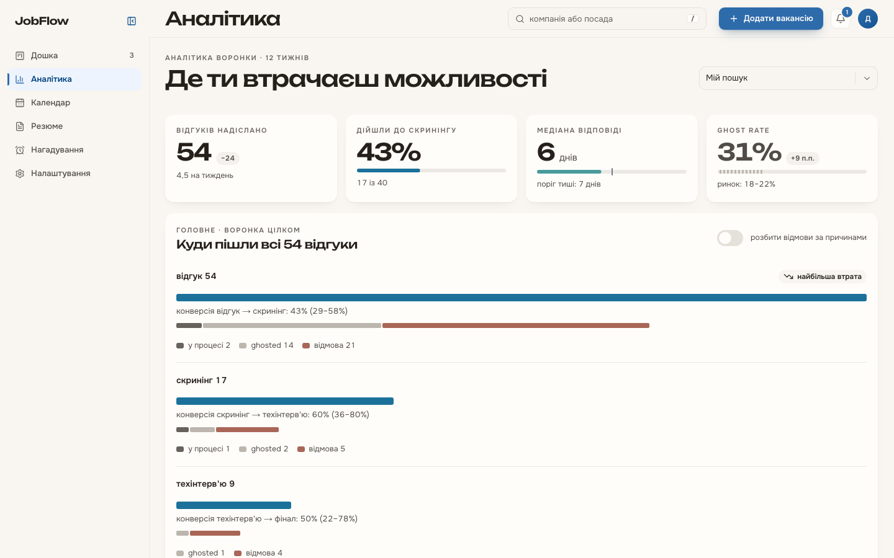
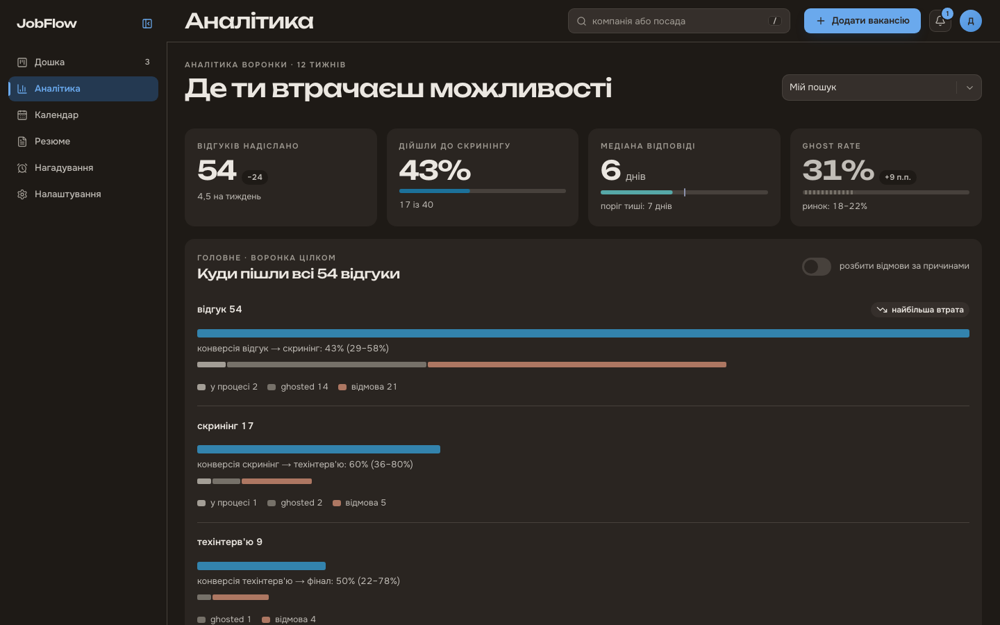
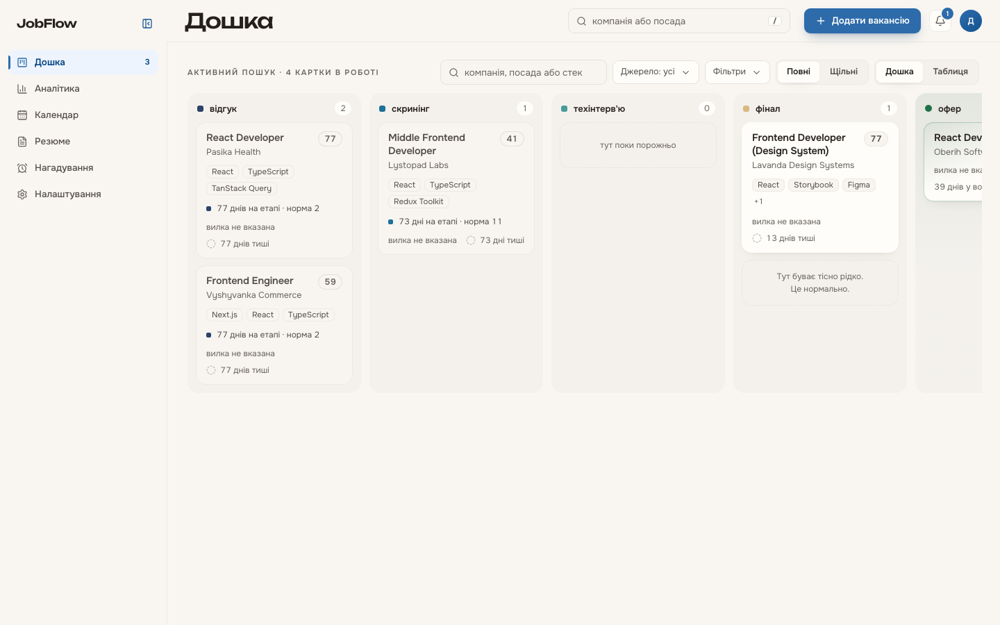
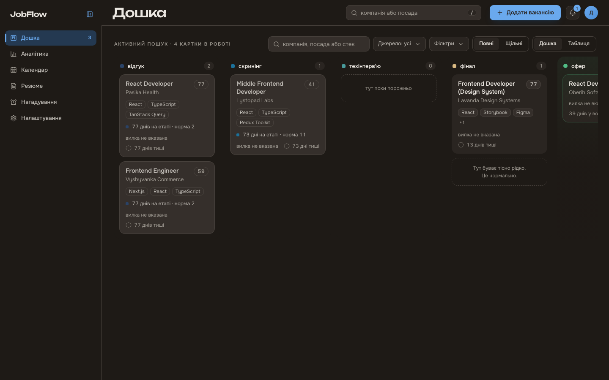
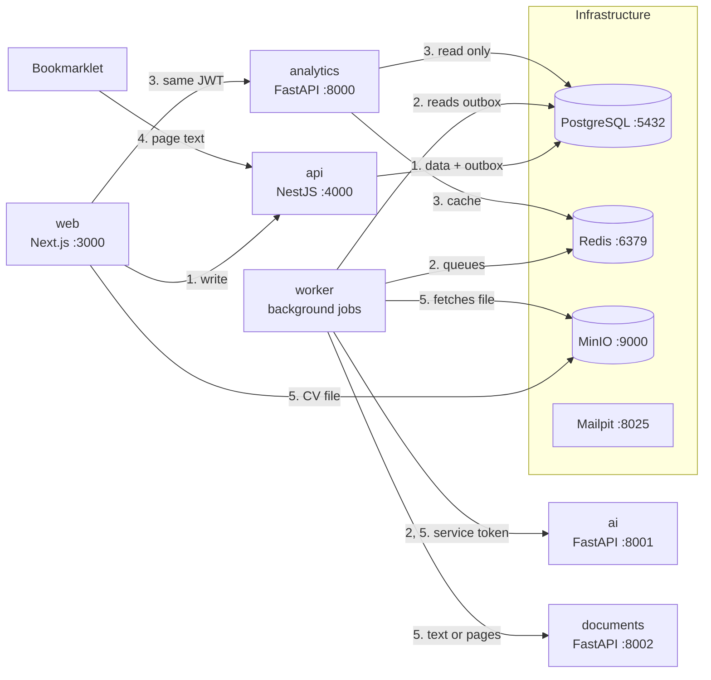

# JobFlow Tracker

[Українська](README.md) | **English**

A job search tracker: every application on a kanban board, a vacancy saved from the open page in one click, AI that parses its text and matches it against your CV, and analytics that show at which stage applications get lost and how far the next offer is. A diploma project: everything runs locally in Docker Compose, with no hosting and no paid services. The interface is in Ukrainian.

## Screenshots

The analytics dashboard and the kanban board on the `pnpm demo:seed` demo data.

| Light theme                                                               | Dark theme                                                              |
| ------------------------------------------------------------------------- | ----------------------------------------------------------------------- |
|  |  |
|             |             |

## Features

- **Kanban board of applications.** Cards are dragged between stages. The stage machine rejects an impossible move, and every move is written to the event log.
- **Bookmarklet.** Saves the vacancy from the open page as a draft. The server never scrapes job sites itself.
- **AI vacancy parsing.** Position, stack, salary and level are filled from the vacancy text, and the user reviews the draft before saving it.
- **CV versions and Match Score.** CVs as PDF, DOCX or a photo. The model maps the vacancy requirements onto the profile, and code computes the score.
- **Follow-up drafts** for the recruiter.
- **Reminders and a calendar.**
- **Notification center** with live updates.
- **Analytics dashboard:** funnel, Sankey of stage transitions, time in each stage, sources, rejection reasons and the offer forecast.
- **Monthly AI summary** with a saved action plan.

## Architecture

A modular monolith: one NestJS API owns every write, every business rule and the one database. The worker runs from the same code with another entry point. Next to it sit three Python services with no data of their own: analytics only reads the database, ai calls the AI provider, documents turns a CV file into text. The reasons are in [ADR-0001](docs/adr/0001-modular-monolith.md), the database schema in [docs/diagrams/erd.md](docs/diagrams/erd.md).



1. **Write.** The browser sends a change to api. Api checks it against the schema and the rules, and writes the data and an `outbox` row in one transaction.
2. **Background jobs.** The worker publishes `outbox` rows to BullMQ queues, checks the AI result cache and the daily limit, calls ai with a 60 second service token, creates reminders and clears the analytics cache.
3. **Analytics read.** The browser calls analytics with the same JWT, which the service checks with the RS256 public key. Analytics reads the database through a read-only role and caches each metric in Redis per user.
4. **Vacancy capture.** The bookmarklet sends the page text with the capture token. Api creates a draft and queues the AI parse, and `Idempotency-Key` keeps a double click from creating two drafts.
5. **CV.** The browser uploads the file to MinIO through a presigned URL. Once the upload is confirmed, the worker fetches the file, documents returns its text or the page images of a scan, and ai builds the profile from them.

## Stack and why

| Part         | Technology                                                   | Why                                                                                                                                                                                                                          |
| ------------ | ------------------------------------------------------------ | ---------------------------------------------------------------------------------------------------------------------------------------------------------------------------------------------------------------------------- |
| API          | NestJS 12, Express 5, Prisma 7                               | Nest modules map onto the controller, service and repository layers, and DI lets tests swap any dependency ([ADR-0017](docs/adr/0017-nestjs-for-the-api.md))                                                                 |
| Database     | PostgreSQL 18                                                | the stage history is append-only and the current stage is its projection, so analytics derive from the history ([ADR-0003](docs/adr/0003-append-only-stage-events.md))                                                       |
| Queues       | Redis 8, BullMQ, transactional outbox                        | an event is written with its data and is not lost when Redis is down ([ADR-0004](docs/adr/0004-transactional-outbox-bullmq.md))                                                                                              |
| Analytics    | Python 3.14, FastAPI, pandas                                 | metrics are easy to compute in pandas, the service only reads the database ([ADR-0002](docs/adr/0002-python-fastapi-analytics.md)), and the Node API never calls it ([ADR-0011](docs/adr/0011-api-never-calls-analytics.md)) |
| AI           | FastAPI, the `openai` and `anthropic` SDKs                   | the provider sits behind a Strategy interface, with a fake provider for development, tests and the demo ([ADR-0009](docs/adr/0009-ai-provider-strategy.md), [ADR-0018](docs/adr/0018-ai-as-a-python-service.md))             |
| Match Score  | model plus code                                              | the model maps requirements onto the profile and code computes the score, so the score can be checked ([ADR-0019](docs/adr/0019-hybrid-match-score.md))                                                                      |
| Documents    | FastAPI, pypdfium2, Pillow, python-docx                      | the CV file becomes text in a separate stateless service ([ADR-0016](docs/adr/0016-document-service.md))                                                                                                                     |
| Web          | Next.js 16, React 19, Tailwind CSS 4, TanStack Query         | feature sliced design layers, with the boundaries checked by lint ([ADR-0013](docs/adr/0013-feature-sliced-design.md))                                                                                                       |
| Charts       | Chart.js 4, chartjs-chart-sankey                             | a Sankey for the funnel and one theme from the design tokens ([ADR-0006](docs/adr/0006-chartjs-sankey.md))                                                                                                                   |
| Live updates | Server Sent Events                                           | one connection per tab with a one-time ticket, because `EventSource` cannot send headers ([ADR-0005](docs/adr/0005-sse-one-time-ticket.md))                                                                                  |
| Auth         | RS256 JWT, refresh token rotation                            | analytics and ai verify the token with the public key from JWKS without knowing a secret ([ADR-0010](docs/adr/0010-rs256-jwt-refresh-rotation.md))                                                                           |
| Capture      | bookmarklet                                                  | the user sends the page text, the server never scrapes job sites ([ADR-0007](docs/adr/0007-no-server-scraping.md))                                                                                                           |
| Tooling      | Node.js 26, pnpm 12, Turborepo, TypeScript 6 and 7, Vitest 4 | the newest stable versions, never a release candidate ([ADR-0015](docs/adr/0015-stack-baseline-2026-10.md))                                                                                                                  |
| Runtime      | Docker Compose                                               | local only, no deployment ([ADR-0008](docs/adr/0008-local-only-no-deployment.md))                                                                                                                                            |

## Quick start

You need:

- Git.
- Docker Desktop or Docker Engine with Compose v2 and at least 6 GB of memory for Docker.
- Node.js 26, the version in `.nvmrc`. With nvm: `nvm install && nvm use` in the repository root.
- pnpm 12.14.0: `npm install -g pnpm@12.14.0`. Node 26 ships without corepack, so pnpm is installed on its own.
- uv and Python 3.14 only for `pnpm dev` and the Python tests. In the quick start every Python service runs in a container.

```bash
git clone https://github.com/Srh-Yakovenko-ua/jobflow-tracker.git
cd jobflow-tracker
nvm use
pnpm install --frozen-lockfile
cp .env.example .env
pnpm gen:keys
pnpm infra:up
pnpm db:migrate
docker compose up -d --build --wait api worker analytics ai documents web
pnpm demo:seed
```

1. `pnpm install --frozen-lockfile` installs the dependencies exactly as `pnpm-lock.yaml` pins them.
2. `cp .env.example .env` creates the root `.env`. The values in `.env.example` fit the local stack, there is nothing to change. Its `COMPOSE_FILE` points at `infra/docker/`, so `docker compose` works from the root without `-f`.
3. `pnpm gen:keys` creates the JWT keys in `.secrets/`, which api and worker mount.
4. `pnpm infra:up` starts Postgres, Redis, MinIO and Mailpit, waits for their healthchecks and creates the `resumes` bucket.
5. `pnpm db:migrate` applies the database migrations.
6. `docker compose up -d --build --wait ...` builds the images and returns once every app is healthy. The first build takes the longest.
7. `pnpm demo:seed` writes a 12 week job search story: 54 applications, three CV versions, AI results and a monthly summary. Running it again restores the same story.

Open http://localhost:3000 and sign in as `demo@jobflow.local` with the password `jobflow-demo`. The analytics dashboard is at http://localhost:3000/analytics.

Stop the stack with `docker compose stop`. The data stays in named volumes.

Development with hot reload (`pnpm dev`), the full ports and commands tables: [docs/getting-started.md](docs/getting-started.md) (in Ukrainian).

## URLs

| What                | URL                                         |
| ------------------- | ------------------------------------------- |
| Web                 | http://localhost:3000                       |
| API, Swagger UI     | http://localhost:4000/api/docs              |
| API, OpenAPI JSON   | http://localhost:4000/api/docs/openapi.json |
| Bull Board (queues) | http://localhost:4000/admin/queues          |
| Analytics, OpenAPI  | http://localhost:8000/docs                  |
| Mailpit             | http://localhost:8025                       |
| MinIO console       | http://localhost:9001                       |

Swagger and Bull Board run in development mode (`NODE_ENV=development`, as in `.env.example`). MinIO console login: `jobflow` / `jobflow-minio` (`MINIO_ROOT_USER` and `MINIO_ROOT_PASSWORD` from `.env.example`).

## AI provider and cost

The default provider is `fake`: it returns fixtures, needs no key and costs nothing. `services/ai/.env` is optional, and without it the ai service starts on `fake`. The demo data already holds finished AI results, so the demo needs no AI calls.

Only the ai service picks the provider. Api knows just its address, `AI_SERVICE_URL`, and the root `.env` holds no vendor keys. To switch to a real model:

```bash
cp services/ai/.env.example services/ai/.env
```

In `services/ai/.env` set `AI_PROVIDER` (`fake`, `anthropic`, `openai` or `nvidia`), `AI_MODEL` and that vendor's key: `ANTHROPIC_API_KEY`, `OPENAI_API_KEY` or `NVIDIA_API_KEY`. Then restart the service:

```bash
docker compose up -d --force-recreate ai
```

A missing key or model stops the service, and it names what is missing, for example `AI_PROVIDER=nvidia needs AI_MODEL, NVIDIA_API_KEY`.

Cost:

- `fake` is free.
- `nvidia` calls the NVIDIA catalog, which is free on its trial.
- `anthropic` and `openai` bill per token at the vendor's price.

Root `.env` variables cap the spending: `AI_DAILY_LIMIT=50` calls per user per day and `AI_MONTHLY_TOKEN_CAP=1000000` tokens per month across all users. `pnpm ai:usage` shows the tokens spent, and fills its cost column once `AI_USD_PER_MILLION_TOKENS_IN` and `AI_USD_PER_MILLION_TOKENS_OUT` are set to the vendor's price. After changing the root `.env`, restart api and worker: `docker compose up -d --force-recreate api worker`.

`pnpm ai:eval <kind>` (`vacancy`, `resume`, `match` or `followup`) checks the model's quality on the running stack. The case sets live in [apps/api/src/modules/ai/evals](apps/api/src/modules/ai/evals).

## Project structure

```
apps/
  web/            Next.js 16 (App Router)
  api/            NestJS 12: entry src/main.ts, AppModule in src/app.module.ts, worker in src/worker.ts
  mobile/         Expo, optional stage
services/
  analytics/      FastAPI (Python 3.14, uv)
  ai/             FastAPI, AI providers, port 8001
  documents/      FastAPI, CV text and pages, port 8002
packages/
  shared/         zod schemas, types, enums, stage machine, thresholds
  config/         shared tsconfig, eslint, prettier presets
bookmarklet/      bookmarklet source and build script
infra/
  docker/         Dockerfiles, compose files, monitoring configs
.github/
  workflows/      CI
docs/             ADRs, design, diagrams for the thesis
```

## Scripts

| Command                                       | What it does                                                        |
| --------------------------------------------- | ------------------------------------------------------------------- |
| `pnpm infra:up`                               | infrastructure containers and the `resumes` bucket                  |
| `pnpm db:migrate`                             | database migrations                                                 |
| `pnpm demo:seed`                              | the demo story for `demo@jobflow.local`                             |
| `pnpm dev`                                    | infrastructure, migrations and the apps on the host with hot reload |
| `pnpm test`, `pnpm test:int`, `pnpm test:e2e` | unit, integration and E2E tests                                     |
| `pnpm lint`, `pnpm typecheck`, `pnpm build`   | ESLint, type check, build                                           |
| `pnpm ai:usage`, `pnpm ai:eval`               | AI tokens and cost, model quality check                             |
| `pnpm ci:local`                               | the same checks as CI                                               |

Every command: [docs/getting-started.md](docs/getting-started.md#команди).

## Tests

| Command                                                                         | What it checks                                                           |
| ------------------------------------------------------------------------------- | ------------------------------------------------------------------------ |
| `pnpm test`                                                                     | the unit tests of every package                                          |
| `pnpm test:int`                                                                 | integration tests on real Postgres and Redis, run `pnpm infra:up` first  |
| `uv run pytest` in `services/analytics`, `services/ai` and `services/documents` | the Python services, needs uv and Python 3.14                            |
| `pnpm ai:eval <kind>`                                                           | model quality on the case sets in [evals](apps/api/src/modules/ai/evals) |
| `pnpm ci:local`                                                                 | the same checks as CI, in the same order                                 |

The Playwright E2E tests in `apps/web/e2e` run in the [E2E](.github/workflows/e2e.yml) workflow on GitHub Actions, on a stack started in the same order as the quick start. Every test registers a new user, and `.env.example` allows only 3 sign-ups an hour, so locally, on a running stack, raise the limits and recreate api and worker first:

```bash
echo 'RATE_LIMIT_REGISTER_PER_HOUR=100' >> .env
echo 'RATE_LIMIT_LOGIN_PER_MINUTE=60' >> .env
docker compose up -d --wait --force-recreate api worker
pnpm --filter @jobflow/web exec playwright install chromium firefox
pnpm test:e2e
```

## Troubleshooting

**A port is busy.** The ports are fixed in `infra/docker/compose.yml`, so free the port rather than change it. `lsof -nP -iTCP:3000 -sTCP:LISTEN` shows the process holding it (use your port number). If it is another compose project, `docker compose ls` shows its name and `docker compose -p <name> stop` stops it.

**Docker runs out of memory.** The stack needs at least 6 GB of memory for Docker. In Docker Desktop that is Settings, Resources, Memory. After the change, restart Docker and run the `docker compose up` command from the quick start again. `docker compose ps` shows which container did not come up.

The other problems and their fixes: [docs/getting-started.md](docs/getting-started.md#типові-проблеми).

## Documentation

- [Getting started](docs/getting-started.md): development, ports, commands, troubleshooting (in Ukrainian).
- [ADRs](docs/adr/README.md): architecture decisions.
- [ERD](docs/diagrams/erd.md): the database schema.
- [Security](docs/security.md).
- [Offer forecast](docs/analytics/offer-forecast.md): how it is computed.
- [OpenAPI](docs/api/openapi.json): the API contract.
- [Design](docs/design/README.md): the design handoff.
- [AI eval](apps/api/src/modules/ai/evals): the case sets for `pnpm ai:eval`.
