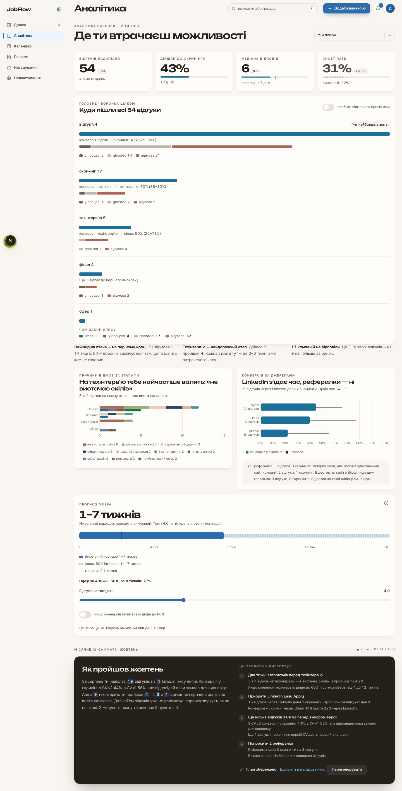
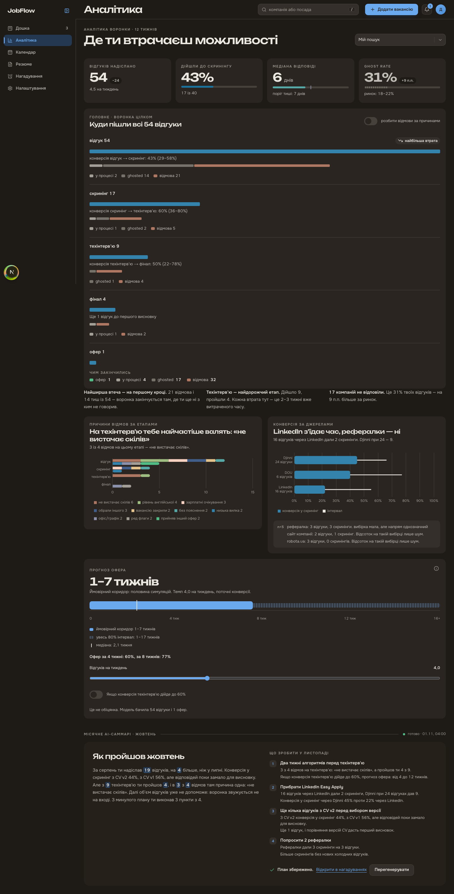
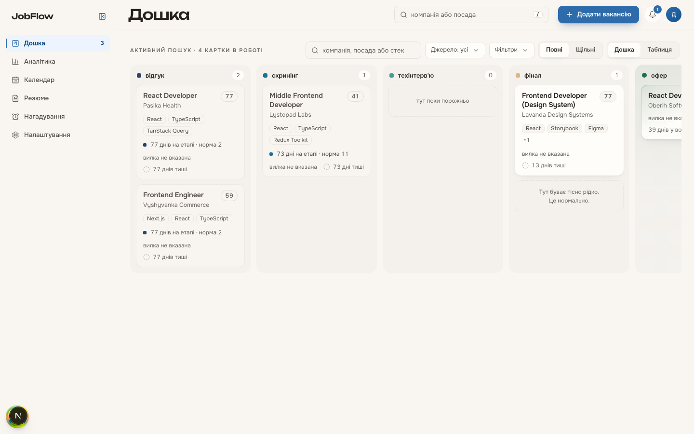
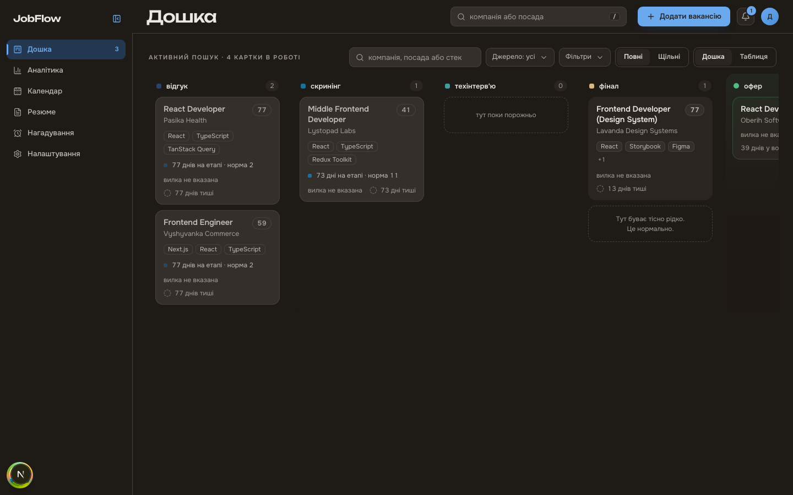
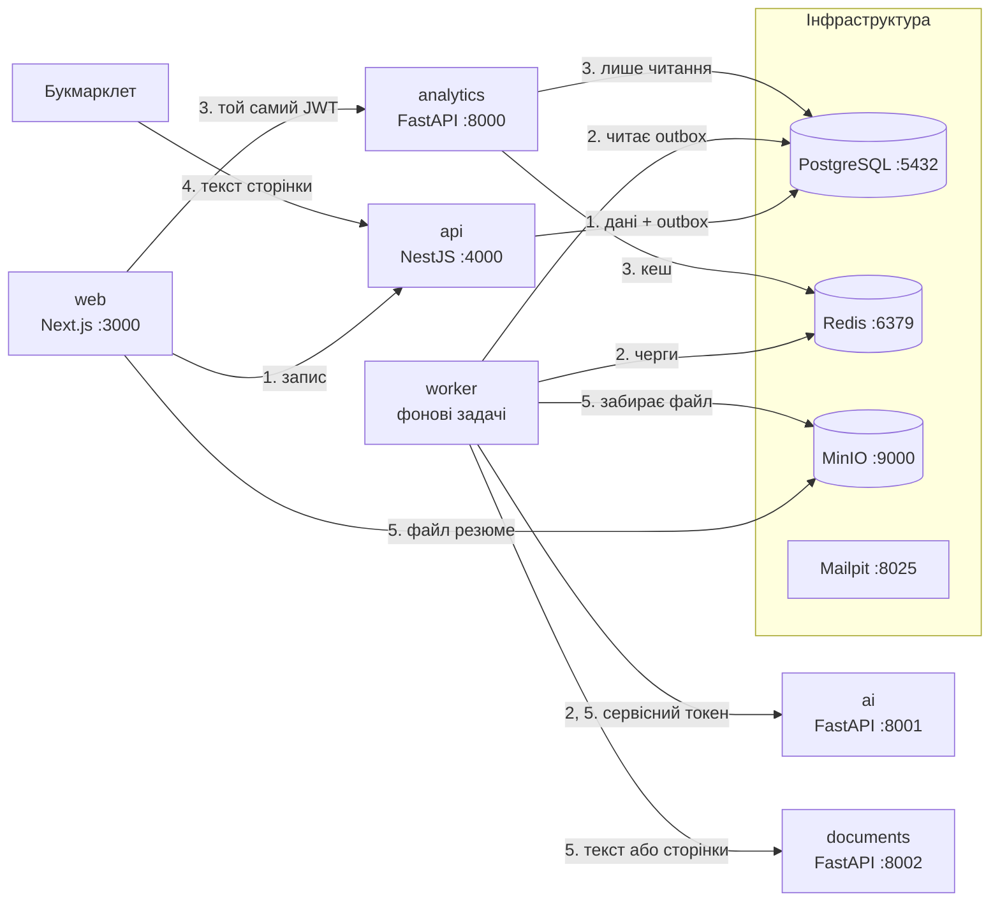

# JobFlow Tracker

**Українська** | [English](README.en.md)

Трекер пошуку роботи: усі відгуки на канбан-дошці, вакансія зберігається з відкритої сторінки одним кліком, AI розбирає її текст і порівнює з резюме, а аналітика показує, на якій стадії губляться відгуки і скільки лишилось до оферу. Дипломний проєкт: усе працює локально в Docker Compose, без хостингу і платних сервісів.

## Скриншоти

Дашборд аналітики і канбан-дошка на демо-даних `pnpm demo:seed`.

| Світла тема                                                             | Темна тема                                                            |
| ----------------------------------------------------------------------- | --------------------------------------------------------------------- |
|  |  |
|           |           |

## Можливості

- **Канбан-дошка відгуків.** Картки перетягуються між стадіями. Неможливий перехід відхиляє машина стадій, а кожен перехід записується в журнал подій.
- **Букмарклет.** Зберігає вакансію з відкритої сторінки як чернетку. Сервер сам сайти вакансій не парсить.
- **AI-розбір вакансії.** Посада, стек, зарплата і рівень заповнюються з тексту вакансії, а користувач перевіряє чернетку перед збереженням.
- **Версії резюме і Match Score.** Резюме в PDF, DOCX або фото. Модель зіставляє вимоги вакансії з профілем, а бал відповідності рахує код.
- **Чернетки follow-up листів** рекрутеру.
- **Нагадування і календар.**
- **Центр сповіщень** з оновленнями в реальному часі.
- **Дашборд аналітики:** воронка, Sankey переходів між стадіями, час на кожній стадії, джерела, причини відмов і прогноз оферу.
- **Місячний AI-підсумок** зі збереженим планом дій.

## Архітектура

Модульний моноліт: один API на NestJS володіє всіма записами, бізнес-правилами і єдиною базою. Worker працює з того самого коду з іншою точкою входу. Поруч три Python-сервіси без власних даних: analytics лише читає базу, ai викликає AI-провайдера, documents перетворює файл резюме на текст. Чому так, описано в [ADR-0001](docs/adr/0001-modular-monolith.md), схема бази в [docs/diagrams/erd.md](docs/diagrams/erd.md).



1. **Запис.** Браузер надсилає зміну в api. Api перевіряє її схемою і правилами, а дані й рядок `outbox` записує в одній транзакції.
2. **Фонові задачі.** Worker публікує рядки `outbox` у черги BullMQ, перевіряє кеш AI-результатів і денний ліміт, викликає ai із сервісним токеном на 60 секунд, створює нагадування і скидає кеш аналітики.
3. **Читання аналітики.** Браузер звертається до analytics з тим самим JWT, який сервіс перевіряє публічним ключем RS256. Базу analytics читає через роль лише для читання і кешує кожну метрику в Redis окремо для кожного користувача.
4. **Захоплення вакансії.** Букмарклет надсилає текст сторінки з capture-токеном. Api створює чернетку і ставить AI-розбір у чергу, а `Idempotency-Key` не дає подвійному кліку створити дві чернетки.
5. **Резюме.** Браузер завантажує файл у MinIO за підписаним URL. Після підтвердження worker забирає файл, documents повертає його текст або зображення сторінок скану, а ai будує з них профіль.

## Стек і чому саме він

| Частина     | Технологія                                                 | Чому                                                                                                                                                                                                   |
| ----------- | ---------------------------------------------------------- | ------------------------------------------------------------------------------------------------------------------------------------------------------------------------------------------------------ |
| API         | NestJS 12, Express 5, Prisma 7                             | модулі Nest лягають на шари controller, service, repository, а DI дає підмінити будь-яку залежність у тестах ([ADR-0017](docs/adr/0017-nestjs-for-the-api.md))                                         |
| База        | PostgreSQL 18                                              | історія стадій лише дописується, поточна стадія є її проєкцією, тому аналітика рахується з історії ([ADR-0003](docs/adr/0003-append-only-stage-events.md))                                             |
| Черги       | Redis 8, BullMQ, transactional outbox                      | подія записується разом з даними і не губиться, навіть коли Redis недоступний ([ADR-0004](docs/adr/0004-transactional-outbox-bullmq.md))                                                               |
| Аналітика   | Python 3.14, FastAPI, pandas                               | метрики зручно рахувати в pandas, сервіс лише читає базу ([ADR-0002](docs/adr/0002-python-fastapi-analytics.md)), а Node API його не викликає ([ADR-0011](docs/adr/0011-api-never-calls-analytics.md)) |
| AI          | FastAPI, SDK `openai` і `anthropic`                        | провайдер за інтерфейсом Strategy і фейковий провайдер для розробки, тестів і демо ([ADR-0009](docs/adr/0009-ai-provider-strategy.md), [ADR-0018](docs/adr/0018-ai-as-a-python-service.md))            |
| Match Score | модель плюс код                                            | модель зіставляє вимоги з профілем, а бал рахує код, тому його можна перевірити ([ADR-0019](docs/adr/0019-hybrid-match-score.md))                                                                      |
| Документи   | FastAPI, pypdfium2, Pillow, python-docx                    | файл резюме перетворюється на текст в окремому сервісі без стану ([ADR-0016](docs/adr/0016-document-service.md))                                                                                       |
| Web         | Next.js 16, React 19, Tailwind CSS 4, TanStack Query       | шари feature sliced design, межі між ними перевіряє лінтер ([ADR-0013](docs/adr/0013-feature-sliced-design.md))                                                                                        |
| Графіки     | Chart.js 4, chartjs-chart-sankey                           | Sankey для воронки і спільна тема з дизайн-токенів ([ADR-0006](docs/adr/0006-chartjs-sankey.md))                                                                                                       |
| Оновлення   | Server Sent Events                                         | одне з'єднання на вкладку з одноразовим квитком, бо `EventSource` не надсилає заголовків ([ADR-0005](docs/adr/0005-sse-one-time-ticket.md))                                                            |
| Авторизація | JWT RS256, ротація refresh-токенів                         | analytics і ai перевіряють токен публічним ключем з JWKS, не знаючи секрету ([ADR-0010](docs/adr/0010-rs256-jwt-refresh-rotation.md))                                                                  |
| Захоплення  | букмарклет                                                 | текст сторінки надсилає користувач, сервер сайти вакансій не парсить ([ADR-0007](docs/adr/0007-no-server-scraping.md))                                                                                 |
| Інструменти | Node.js 26, pnpm 12, Turborepo, TypeScript 6 і 7, Vitest 4 | найновіші стабільні версії, без release candidate ([ADR-0015](docs/adr/0015-stack-baseline-2026-10.md))                                                                                                |
| Запуск      | Docker Compose                                             | лише локально, без деплою ([ADR-0008](docs/adr/0008-local-only-no-deployment.md))                                                                                                                      |

## Швидкий старт

Потрібно:

- Git.
- Docker Desktop або Docker Engine з Compose v2 і щонайменше 6 ГБ пам'яті для Docker.
- Node.js 26, версія записана в `.nvmrc`. З nvm: `nvm install && nvm use` у корені репозиторію.
- pnpm 12.14.0: `npm install -g pnpm@12.14.0`. Node 26 постачається без corepack, тому pnpm ставиться окремо.
- uv і Python 3.14 потрібні лише для `pnpm dev` і Python-тестів. У швидкому старті всі Python-сервіси працюють у контейнерах.

Команди нижче написані для bash або zsh: macOS, Linux або WSL2 на Windows.

Клон і залежності:

```bash
git clone https://github.com/Srh-Yakovenko-ua/jobflow-tracker.git
cd jobflow-tracker
nvm use
pnpm install --frozen-lockfile
```

`pnpm install --frozen-lockfile` ставить залежності точно за `pnpm-lock.yaml`.

Стек з демо-даними:

<!-- quick-start -->

```bash
cp .env.example .env
echo 'COMPOSE_FILE=infra/docker/compose.yml:infra/docker/compose.ci.yml' >> .env
pnpm gen:keys
chmod -R a+rX .secrets
pnpm infra:up
pnpm db:migrate
docker compose up -d --build --wait api worker analytics ai documents web
pnpm demo:seed
```

<!-- /quick-start -->

1. `cp .env.example .env` створює кореневий `.env`, значення з `.env.example` підходять для локального стеку.
2. Рядок `COMPOSE_FILE` обирає продакшн-образи з `infra/docker/compose.ci.yml`, і оскільки в `.env` діє останнє значення ключа, `docker compose` з кореня працює з ними і в нових терміналах.
3. `pnpm gen:keys` створює ключі JWT у `.secrets/`.
4. `chmod -R a+rX .secrets` дає контейнерам api і worker прочитати ключі, які вони монтують з `.secrets/`, бо на Linux і WSL2 приватний ключ інакше читає лише ваш користувач.
5. `pnpm infra:up` піднімає Postgres, Redis, MinIO і Mailpit, чекає їхніх healthcheck-ів і створює бакет `resumes`.
6. `pnpm db:migrate` застосовує міграції бази.
7. `docker compose up -d --build --wait ...` збирає продакшн-образи застосунків і повертає керування, коли всі вони стануть healthy, а перша збірка триває найдовше.
8. `pnpm demo:seed` записує 12-тижневу історію пошуку (54 відгуки, три версії резюме, AI-результати і місячний підсумок), а повторний запуск відновлює ту саму історію.

Відкрийте http://localhost:3000/login, увійдіть як `demo@jobflow.local` з паролем `jobflow-demo` і перейдіть на дашборд аналітики http://localhost:3000/analytics.

Зупинити стек: `docker compose stop`. Дані залишаються в іменованих томах.

CI проганяє саме цей блок: workflow [E2E](.github/workflows/e2e.yml) бере команди між маркерами `quick-start` з цього файлу, виконує їх і запускає тести Playwright, серед них вхід демо-акаунтом і перевірку `/analytics`.

Розробка з hot reload (`pnpm dev`), повна таблиця портів і команд: [docs/getting-started.md](docs/getting-started.md).

## Адреси

| Що                 | Адреса                                         |
| ------------------ | ---------------------------------------------- |
| Web                | http://localhost:3000                          |
| API, контракт      | [docs/api/openapi.json](docs/api/openapi.json) |
| Analytics, OpenAPI | http://localhost:8000/docs                     |
| Mailpit            | http://localhost:8025                          |
| MinIO, консоль     | http://localhost:9001                          |

Вхід у консоль MinIO: `jobflow` / `jobflow-minio` (`MINIO_ROOT_USER` і `MINIO_ROOT_PASSWORD` з `.env.example`).

Api у швидкому старті працює з `NODE_ENV=production`, тому Swagger UI (http://localhost:4000/api/docs) і Bull Board є лише в режимі розробки `pnpm dev`, як описано в [docs/getting-started.md](docs/getting-started.md).

## AI-провайдер і вартість

За замовчуванням працює провайдер `fake`: він повертає фікстури, ключ йому не потрібен, і нічого не коштує. Файл `services/ai/.env` необов'язковий, без нього сервіс ai стартує з `fake`. Демо-дані вже містять готові AI-результати, тому для демо AI-виклики не потрібні.

Провайдера обирає лише сервіс ai. Api знає тільки його адресу `AI_SERVICE_URL`, ключів вендорів у кореневому `.env` немає. Перемкнути на справжню модель:

```bash
cp services/ai/.env.example services/ai/.env
```

У `services/ai/.env` задайте `AI_PROVIDER` (`fake`, `anthropic`, `openai` або `nvidia`), `AI_MODEL` і ключ цього вендора: `ANTHROPIC_API_KEY`, `OPENAI_API_KEY` або `NVIDIA_API_KEY`. Потім перезапустіть сервіс, на стеку швидкого старту так само:

```bash
docker compose up -d --force-recreate ai
```

Якщо ключа чи моделі бракує, сервіс не стартує і називає, чого бракує, наприклад `AI_PROVIDER=nvidia needs AI_MODEL, NVIDIA_API_KEY`.

Вартість:

- `fake` безкоштовний.
- `nvidia` звертається до каталогу NVIDIA, безкоштовного на пробному доступі.
- `anthropic` і `openai` рахують за токени за ціною вендора.

Витрати обмежують змінні кореневого `.env`: `AI_DAILY_LIMIT=50` викликів на користувача за день і `AI_MONTHLY_TOKEN_CAP=1000000` токенів на місяць для всіх користувачів разом. `pnpm ai:usage` показує витрачені токени, а колонку вартості рахує, коли `AI_USD_PER_MILLION_TOKENS_IN` і `AI_USD_PER_MILLION_TOKENS_OUT` дорівнюють ціні вендора. Після зміни кореневого `.env` перезапустіть api і worker: `docker compose up -d --force-recreate api worker`.

Якість моделі перевіряє `pnpm ai:eval <вид>` (`vacancy`, `resume`, `match` або `followup`) на запущеному стеку. Набори кейсів лежать в [apps/api/src/modules/ai/evals](apps/api/src/modules/ai/evals).

## Структура

```
apps/
  web/            Next.js 16 (App Router)
  api/            NestJS 12: точка входу src/main.ts, AppModule у src/app.module.ts, worker у src/worker.ts
services/
  analytics/      FastAPI (Python 3.14, uv)
  ai/             FastAPI, AI-провайдери, порт 8001
  documents/      FastAPI, текст і сторінки резюме, порт 8002
packages/
  shared/         zod-схеми, типи, enum-и, машина стадій, пороги
  config/         спільні пресети tsconfig, eslint, prettier
bookmarklet/      код букмарклета і скрипт збірки
infra/
  docker/         compose-файли, ініціалізація Postgres
.github/
  workflows/      CI
docs/             ADR, дизайн, діаграми до диплому
```

## Скрипти

| Команда                                       | Що робить                                                                                                                                                                                 |
| --------------------------------------------- | ----------------------------------------------------------------------------------------------------------------------------------------------------------------------------------------- |
| `pnpm infra:up`                               | контейнери інфраструктури і бакет `resumes`                                                                                                                                               |
| `pnpm db:migrate`                             | міграції бази                                                                                                                                                                             |
| `pnpm demo:seed`                              | демо-історія для `demo@jobflow.local`                                                                                                                                                     |
| `pnpm dev`                                    | інфраструктура, міграції і застосунки на хості з hot reload                                                                                                                               |
| `pnpm test`, `pnpm test:int`, `pnpm test:e2e` | unit, інтеграційні і E2E-тести                                                                                                                                                            |
| `pnpm lint`, `pnpm typecheck`, `pnpm build`   | ESLint, перевірка типів, збірка                                                                                                                                                           |
| `pnpm ai:usage`, `pnpm ai:eval`               | токени і вартість AI, перевірка якості моделі                                                                                                                                             |
| `pnpm ci:local`                               | ті самі перевірки, що й CI                                                                                                                                                                |
| `pnpm docs:build`                             | діаграми, ER-діаграма, OpenAPI у HTML і PDF, таблиці й перелік рисунків у `docs/thesis/build`, без мережі                                                                                 |
| `pnpm docs:data`                              | оновлює знімки в `docs/thesis/data` і скриншоти; потрібні запущений стек, `pnpm demo:seed` і справжній AI-провайдер у `services/ai/.env`; web не на 3000 задається через `THESIS_WEB_URL` |

Усі команди: [docs/getting-started.md](docs/getting-started.md#команди).

## Тести

| Команда                                                                      | Що перевіряє                                                             |
| ---------------------------------------------------------------------------- | ------------------------------------------------------------------------ |
| `pnpm test`                                                                  | unit-тести всіх пакетів                                                  |
| `pnpm test:int`                                                              | інтеграційні тести на справжніх Postgres і Redis, спершу `pnpm infra:up` |
| `uv run pytest` у `services/analytics`, `services/ai` і `services/documents` | Python-сервіси, потрібні uv і Python 3.14                                |
| `pnpm ai:eval <вид>`                                                         | якість моделі на наборах кейсів з [evals](apps/api/src/modules/ai/evals) |
| `pnpm ci:local`                                                              | ті самі перевірки, що й CI, у тому ж порядку                             |

E2E-тести Playwright з `apps/web/e2e` проганяє workflow [E2E](.github/workflows/e2e.yml) у GitHub Actions на стеку, який піднімає блок швидкого старту з цього README. Кожен тест реєструє нового користувача, а `.env.example` дозволяє лише 3 реєстрації на годину, тому локально на стеку швидкого старту спершу підніміть ліміти і перезапустіть api:

```bash
echo 'RATE_LIMIT_REGISTER_PER_HOUR=100' >> .env
echo 'RATE_LIMIT_LOGIN_PER_MINUTE=60' >> .env
docker compose up -d --wait --force-recreate api
pnpm --filter @jobflow/web exec playwright install chromium firefox
pnpm test:e2e
```

## Типові проблеми

**Порт уже зайнятий.** Порти зафіксовані в `infra/docker/compose.yml`, тому звільніть порт, а не міняйте його. `lsof -nP -iTCP:3000 -sTCP:LISTEN` покаже процес, що його тримає (підставте свій номер). Якщо це інший проєкт compose, `docker compose ls` покаже його назву, а `docker compose -p <назва> stop` зупинить.

**Docker не вистачає пам'яті.** Стеку потрібно щонайменше 6 ГБ пам'яті для Docker, бо перша збірка виконує `next build` всередині Docker. У Docker Desktop її задає Settings, Resources, Memory. Після зміни перезапустіть Docker і повторіть команду `docker compose up` зі швидкого старту. Який контейнер не піднявся, покаже `docker compose ps`.

**Застарілі образи після `git pull`.** Повторіть рядок `docker compose up -d --build --wait ...` зі швидкого старту: `--build` перезбирає образи зі зміненого коду. Якщо в pull прийшли нові міграції, спершу виконайте `pnpm db:migrate`.

**Повернутися до dev-контейнерів.** Зупиніть стек (`docker compose stop`) і видаліть з `.env` дописаний рядок `COMPOSE_FILE=infra/docker/compose.yml:infra/docker/compose.ci.yml`. Тоді діє рядок `COMPOSE_FILE` з `.env.example`, який підключає `compose.override.yml`, і `docker compose` знову збирає цілі `dev` з hot reload, як описано в [docs/getting-started.md](docs/getting-started.md).

Решта проблем і їхні рішення: [docs/getting-started.md](docs/getting-started.md#типові-проблеми).

## Документація

- [Початок роботи](docs/getting-started.md): розробка, порти, команди, проблеми.
- [ADR](docs/adr/README.md): архітектурні рішення.
- [ERD](docs/diagrams/erd.md): схема бази.
- [Безпека](docs/security.md).
- [Прогноз оферу](docs/analytics/offer-forecast.md): як рахується.
- [OpenAPI](docs/api/openapi.json): контракт API.
- [Дизайн](docs/design/README.md): дизайн-хендоф.
- [AI eval](apps/api/src/modules/ai/evals): набори кейсів для `pnpm ai:eval`.
- [Доступність](apps/web/e2e/a11y.test.ts): перевірка axe в E2E-тестах.
