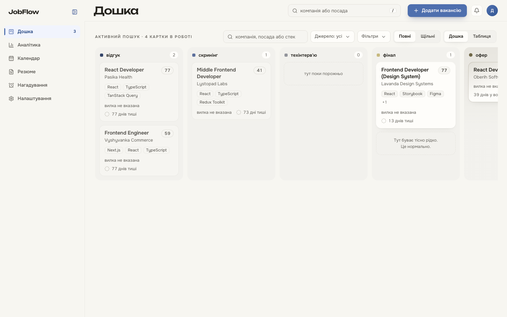
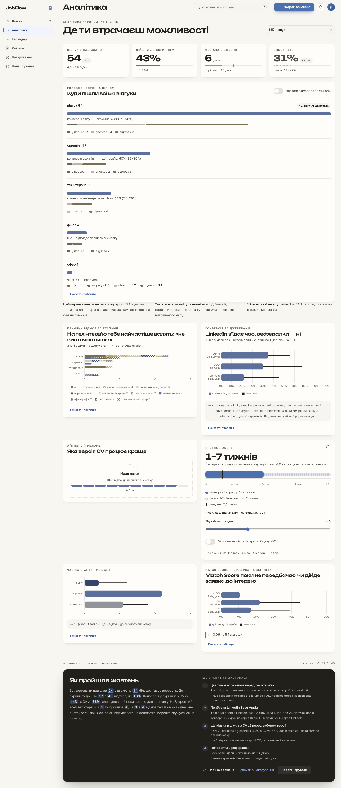
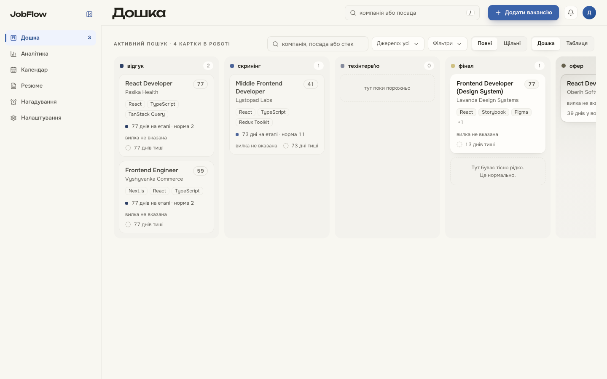
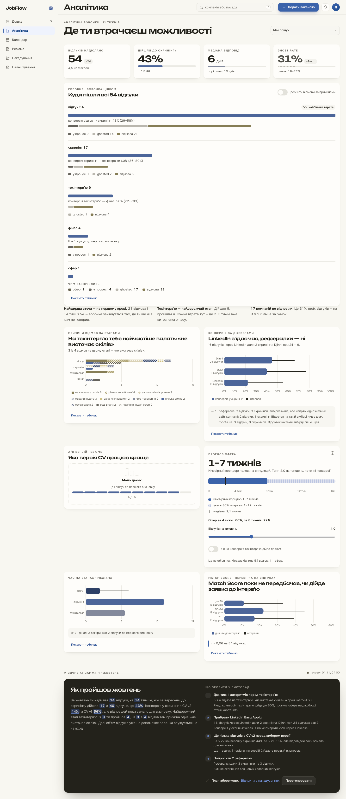
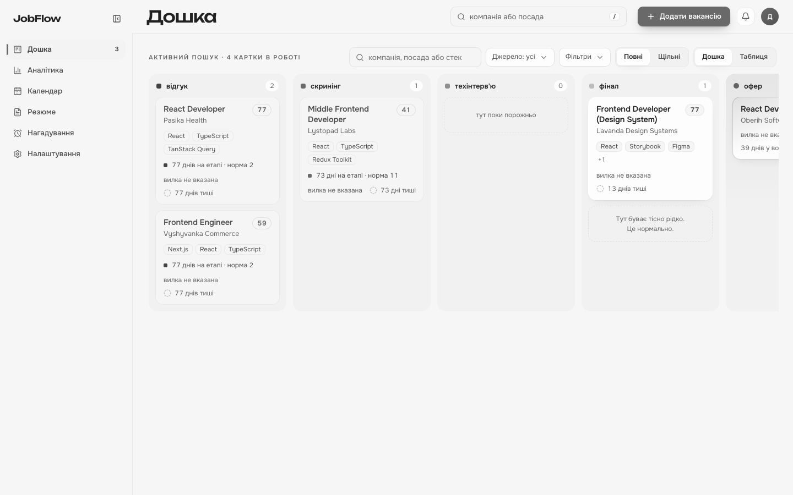
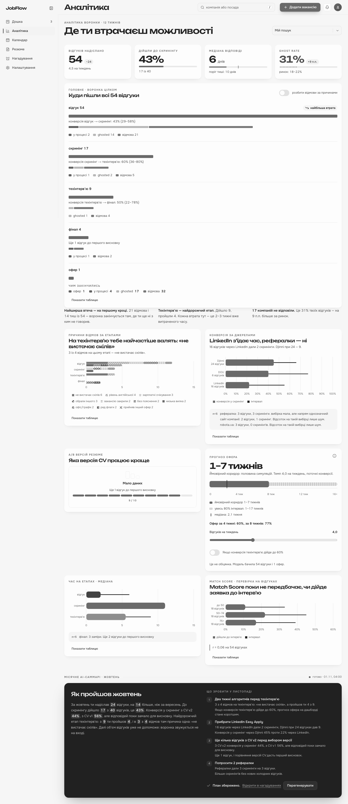

# Accessibility

This chapter audits JobFlow against WCAG 2.2 level AA: keyboard use, screen
readers, colour vision and contrast. It names the method of each check and the
screens it reached, then the findings with their fixes, each with the test that
proves it. Formal certification is out of scope.

The goals are the ones the FIN-03 card sets:

- no serious or critical axe violation on any screen;
- a Lighthouse accessibility score of 95 or more on every screen;
- every text token pair at 4.5:1 or more in both themes.

## Method

| Check             | Tool and settings                                                                                                                                                                                                                                                                                                                                                  | Proof                                                                                          |
| ----------------- | ------------------------------------------------------------------------------------------------------------------------------------------------------------------------------------------------------------------------------------------------------------------------------------------------------------------------------------------------------------------ | ---------------------------------------------------------------------------------------------- |
| axe, every route  | `@axe-core/playwright` with axe-core 4.14.0 and the tags `wcag2a`, `wcag2aa`, `wcag21a`, `wcag21aa` and `wcag22aa`. A serious or critical violation fails the test; minor and moderate ones are not counted. Each page also has to have `lang="uk"`, one `h1`, one `main` and the toast region.                                                                    | `apps/web/e2e/a11y.test.ts`, `apps/web/e2e/test/axe.ts`                                        |
| axe, charts drawn | The same run on the dashboard with the design data routed in (`routeDesignAnalytics`), all charts drawn and the funnel data table open, in light and dark.                                                                                                                                                                                                         | `apps/web/e2e/dashboard.test.ts`                                                               |
| axe, components   | `axeViolations` in the Vitest and Testing Library suites of the web app.                                                                                                                                                                                                                                                                                           | `apps/web/src/test/axe.ts`                                                                     |
| Lighthouse        | Lighthouse 13.6.0, accessibility category only, driven from Playwright in its own `lighthouse` project. One persistent Chromium context with a debugging port is shared, so the tab Lighthouse opens keeps the session cookie. Flags: `formFactor: 'desktop'`, `screenEmulation: { disabled: true }`, `throttlingMethod: 'provided'`, `disableStorageReset: true`. | `apps/web/e2e/lighthouse.test.ts`, writes `docs/thesis/data/lighthouse.tsv`                    |
| Contrast          | WCAG relative luminance over `packages/shared/tokens/tokens.json`, for every pair in `TEXT_PAIRS`: the text tokens on the surfaces they are drawn on, in light and in dark, plus the danger button's text on its 6% and 10% tint composited over the surface under it. Minimum 4.5:1 for every pair.                                                               | `packages/shared/src/tokens/contrast.test.ts`, `pnpm --filter @jobflow/shared tokens:contrast` |
| Colour vision     | Chromium's vision deficiency emulation (`Emulation.setEmulatedVisionDeficiency` over the DevTools protocol) for protanopia, deuteranopia and achromatopsia, on the demo user's board and dashboard in the light theme.                                                                                                                                             | `apps/web/e2e/thesis/screens.shot.ts`                                                          |
| Keyboard          | Keyboard-only walks in Playwright and Testing Library: Tab order, the board's keyboard drag, the dialog focus trap, Escape and focus return.                                                                                                                                                                                                                       | [Keyboard pass](#keyboard-pass)                                                                |
| Screen reader     | The accessibility tree that NVDA and VoiceOver read, checked through role and accessible name queries and the drag live region. No session with a running screen reader is recorded.                                                                                                                                                                               | [Screen reader pass](#screen-reader-pass)                                                      |

### Which check reached which screen

The axe and Lighthouse runs sign up a fresh user and add one application by
hand, so the dashboard and the monthly summary are audited below their data
thresholds. The charts with data are covered by the design data run of
`dashboard.test.ts`. The axe runs use the Playwright Desktop Chrome viewport
(1280 × 720); the narrow run uses 390 × 844.

| Screen        | Route                        | axe, light and dark | axe, 390 px             | Lighthouse score | Colour vision | Keyboard and tree     |
| ------------- | ---------------------------- | ------------------- | ----------------------- | ---------------- | ------------- | --------------------- |
| login         | `/login`                     | yes                 |                         | 100              |               |                       |
| register      | `/register`                  | yes                 |                         | 100              |               |                       |
| board         | `/board`                     | yes                 |                         | 100              | yes           | drag, live region     |
| applications  | `/applications`              | yes                 |                         | 100              |               | bulk withdraw confirm |
| calendar      | `/calendar`                  | yes                 |                         | 100              |               |                       |
| add           | `/add`                       | yes                 |                         | 100              |               | headings, focus       |
| dashboard     | `/analytics`                 | yes, plus data      |                         | 100              | yes           | table toggle          |
| summary       | `/analytics/summary/2026-10` | yes                 |                         | 100              |               |                       |
| reminders     | `/reminders`                 | yes                 |                         | 100              |               |                       |
| notifications | `/notifications`             | yes                 | yes                     | 100              |               |                       |
| resumes       | `/resumes`                   | yes                 |                         | 100              |               |                       |
| settings      | `/settings`                  | yes                 | confirm, light and dark | 100              |               | confirm hit area      |
| application   | `/applications/:id`          | yes                 | yes                     | 100              |               | Tab order of regions  |

Every signed-in screen is also checked at 390 px for sideways scrolling
(WCAG 1.4.10 Reflow). Lighthouse runs in the light theme only: its flags have
no colour scheme setting, and dark is covered by axe and the contrast check.

## Findings and fixes

| Finding                                                                                                                                                                                                                                                                                          | WCAG 2.2                                              | Fix                                                                                                                                                                                                                                                                                                                                                                                       | Test                                                                                                                                                                                                                                                                                                                                   |
| ------------------------------------------------------------------------------------------------------------------------------------------------------------------------------------------------------------------------------------------------------------------------------------------------ | ----------------------------------------------------- | ----------------------------------------------------------------------------------------------------------------------------------------------------------------------------------------------------------------------------------------------------------------------------------------------------------------------------------------------------------------------------------------- | -------------------------------------------------------------------------------------------------------------------------------------------------------------------------------------------------------------------------------------------------------------------------------------------------------------------------------------- |
| The confirms that destroy data opened as `role="dialog"`, so a screen reader did not announce them as an alert.                                                                                                                                                                                  | 4.1.2 Name, Role, Value                               | A new `AlertDialogContent` beside `DialogContent` in `shared/ui/dialog.tsx`, both drawn by one private surface; only the role differs. Five confirms use it: delete an application, bulk withdraw, delete all AI results, and regenerate and revoke the bookmarklet token. The question is the accessible name and the text the description.                                              | `apps/web/src/shared/ui/dialog.test.tsx`, `apps/web/src/shared/ui/confirm-dialog.test.tsx`, `apps/web/src/features/delete-application/ui/delete-application-dialog.test.tsx`, `apps/web/src/features/delete-ai-results/ui/delete-ai-results-dialog.test.tsx`, `apps/web/src/widgets/applications-table/ui/applications-table.test.tsx` |
| The confirm footer buttons (Скасувати, Видалити) were drawn 36 px tall, and nothing gave them a 44 px touch area at 390 px.                                                                                                                                                                      | 2.5.8 Target Size (Minimum)                           | Both buttons take the touch height below `md`. 36 px already met the 24 px of 2.5.8; 44 px is the project's own touch target.                                                                                                                                                                                                                                                             | `apps/web/src/shared/ui/confirm-footer.test.tsx`; the 390 px test of `apps/web/e2e/a11y.test.ts` opens the `/settings` delete confirm and hit-tests 21 px above and below the centre of each button with `elementFromPoint`                                                                                                            |
| In dark the confirm button of every destructive confirm (Видалити, Відкликати) drew `danger` text on a 6% `danger` tint over the `surface-2` footer: 4.33:1 at rest and 4.05:1 on hover (10% tint). The contrast check had no pair for a tinted surface, and no axe run scanned an open confirm. | 1.4.3 Contrast (Minimum)                              | In dark the footer's confirm button drops the tint: transparent over `surface-2` at rest (4.74:1), `surface-3` on hover and press (6.22:1), the same hover as the cancel button. Light keeps the drawn tint (6.23:1 and 5.88:1). `TEXT_PAIRS` now checks the danger button on its 6% and 10% tint composited over the surface it sits on: `surface` in both themes, `surface-2` in light. | `packages/shared/src/tokens/contrast.test.ts`, `apps/web/src/shared/ui/confirm-footer.test.tsx`; the 390 px test of `apps/web/e2e/a11y.test.ts` runs axe on the open `/settings` confirm in light and dark                                                                                                                             |
| Every `IconAction` button had an `aria-label`, and its tooltip with the same text set `aria-describedby` on the button while open, so a screen reader read the label twice ("Редагувати рекрутера, Редагувати рекрутера").                                                                       | 4.1.2 Name, Role, Value; 1.3.1 Info and Relationships | `IconAction` passes `describes={false}` to `Tooltip`, so a wrapper span is the tooltip trigger and the button keeps only its name. The tooltip still opens on keyboard focus.                                                                                                                                                                                                             | `apps/web/src/shared/ui/icon-action.test.tsx`                                                                                                                                                                                                                                                                                          |
| The charts had a screen reader table and an `aria-label` summary, but a sighted user who cannot tell the colours apart had no way to see the numbers.                                                                                                                                            | 1.1.1 Non-text Content; 1.3.1 Info and Relationships  | The shared `ChartTable` has a visible Показати таблицю / Сховати таблицю button with `aria-expanded` and `aria-controls`. Collapsed, the table stays in the accessibility tree; expanded, it is shown. It covers the funnel, the rejection reasons and the evidence bars (sources, time on stage, Match Score).                                                                           | `apps/web/src/shared/ui/chart-table.test.tsx`, `apps/web/e2e/dashboard.test.ts`                                                                                                                                                                                                                                                        |
| In the stacked rejection reasons chart, colour alone told the segments of a stack apart.                                                                                                                                                                                                         | 1.4.1 Use of Color                                    | Each reason gets a canvas pattern (solid, stripes, dots, cross, grid, dashes), different from every other reason on its side; the Chart.js legend paints the same pattern beside the label.                                                                                                                                                                                               | `apps/web/src/shared/lib/chart/reason-patterns.test.ts`                                                                                                                                                                                                                                                                                |
| The axe runs used the WCAG 2.0 and 2.1 tags only, so rules new in 2.2 (such as `target-size`) never ran.                                                                                                                                                                                         | 2.5.8 and the 2.2 AA set                              | `wcag22aa` added to the tags in `apps/web/e2e/test/axe.ts`.                                                                                                                                                                                                                                                                                                                               | `apps/web/e2e/a11y.test.ts`, `apps/web/e2e/dashboard.test.ts`                                                                                                                                                                                                                                                                          |

The other charts already pair colour with text: the funnel names each stage
and each ending with its count, the interval bars and the forecast carry axis
labels and values, and the Match Score bars name their score bands.

## Keyboard pass

| Check                           | Result                                                                                                                                                                                                       | Test                                                                                                                       |
| ------------------------------- | ------------------------------------------------------------------------------------------------------------------------------------------------------------------------------------------------------------ | -------------------------------------------------------------------------------------------------------------------------- |
| Skip link (2.4.1)               | The first Tab stop is Перейти до вмісту, which jumps to `#main`.                                                                                                                                             | `apps/web/src/widgets/app-shell/ui/app-shell.test.tsx`                                                                     |
| Sidebar order (2.4.3)           | Tab walks the skip link, the collapse toggle, Дошка, Аналітика, Календар, Резюме, Нагадування, Налаштування, the search, Додати вакансію and the user menu, in that order.                                   | `apps/web/src/widgets/app-shell/ui/app-shell.test.tsx`                                                                     |
| Board drag by keyboard (2.1.1)  | dnd-kit's `KeyboardSensor`: Space picks a card up, the arrows move it between columns, Space drops it and Escape or Tab cancels. Refused stages are skipped, and after a drop or a 409 the card keeps focus. | `apps/web/e2e/reject-undo.test.ts` (`keyboardMove`), `apps/web/src/widgets/kanban-board/ui/kanban-board-keyboard.test.tsx` |
| Focus trap in dialogs (2.4.3)   | Tab cycles from the close button to the last action and back, inside both `dialog` and `alertdialog`.                                                                                                        | `apps/web/src/shared/ui/dialog.test.tsx`                                                                                   |
| Escape and focus return (2.1.2) | Escape closes a dialog and focus goes back to its trigger; a confirm closed by its action also returns focus to the trigger.                                                                                 | `apps/web/src/shared/ui/dialog.test.tsx`, `apps/web/src/shared/ui/confirm-dialog.test.tsx`                                 |
| Region order at 390 px (1.3.2)  | On the application page, Tab reaches the follow-up before the notes.                                                                                                                                         | `apps/web/e2e/a11y.test.ts`                                                                                                |
| Toasts                          | A toast that names a refused move closes from the keyboard.                                                                                                                                                  | `apps/web/e2e/reject-undo.test.ts`                                                                                         |

## Screen reader pass

The pass reads the accessibility tree, the roles, names, descriptions and live
regions that NVDA and VoiceOver speak, through Playwright and Testing Library
role queries. It covers three screens.

- **Board.** Each card is a link with its own role description, and each
  column is a section headed by its stage name. During a keyboard drag the
  live region announces the pick up, the column under the card, the drop and a
  cancel (`apps/web/src/widgets/kanban-board/model/drag-announcements.ts`).
  `keyboardMove` in `apps/web/e2e/test/board.ts` steers by reading that live
  region until it names the target column, and
  `kanban-board-keyboard.test.tsx` checks the announcements. The key hint
  under a picked card is hidden from the screen reader, since the live region
  already speaks.
- **Add flow.** One heading holds the bookmarklet, the paste form and the
  manual form. `path=paste` puts focus in the text field. A failed AI parse
  shows its reason with no axe violation
  (`apps/web/src/widgets/add-application-page/ui/add-application-page.test.tsx`),
  and `apps/web/e2e/capture-paste.test.ts` walks a paste to the board.
- **Dashboard.** The funnel is a list named by its title, its data table is
  named by its caption, the forecast is a named region with its method
  button, the insight notes are a named group and the plan is a named list
  (`apps/web/e2e/dashboard.test.ts`).

The destructive confirms are announced as alert dialogs with the question as
the name and the text as the description, and icon buttons are announced once,
by name only (see the findings above).

## Colour vision

Six screenshots of the demo user in the light theme, made with Chromium's
vision deficiency emulation.

| Board                                                        | Dashboard                                                            |
| ------------------------------------------------------------ | -------------------------------------------------------------------- |
|        |        |
|    |    |
|  |  |

What they show:

- The board names every column and every card in text, so no state depends on
  colour.
- In achromatopsia the rejection reasons chart keeps its segments apart by
  pattern, and its legend shows the same patterns.
- The funnel segments (in progress, ghosted, rejected) differ by lightness
  only. The label line under each bar names them in the same order with their
  counts, and the table toggle shows the numbers.

## Lighthouse

The `lighthouse` project of `pnpm test:e2e` audits the 13 screens of the table
above, one test per screen, and fails a score below 95 with the ids of the
failing audits in its message. When all 13 have run, it writes
[`docs/thesis/data/lighthouse.tsv`](thesis/data/lighthouse.tsv) with the
columns screen, route, score, minimum and result; `pnpm docs:build` renders it
as the thesis table "Оцінка доступності Lighthouse по екранах". The `e2e` job of
CI runs it with the rest of `pnpm test:e2e`.

The recorded run (2026-11-15, against the web dev server with the api, worker
and analytics up) scored 100 on all 13 screens; the score column of the screen
table above comes from that file.

## Contrast

`TEXT_PAIRS` in `packages/shared/src/tokens/contrast.ts` lists 36 pairs; 32
are checked in both themes, the accent-press hover pair once per theme,
because light draws `surface` on it and dark draws `paper`, and the danger tint
over `surface-2` in light only, because the dark confirm footer draws the
button without it. That gives 68 rows, all at 4.5:1 or more. `contrast.test.ts` fails when any pair drops below, and
`pnpm --filter @jobflow/shared tokens:contrast` writes
[`docs/thesis/data/contrast.tsv`](thesis/data/contrast.tsv) and exits 1 on a
failing pair.

Text tokens on the neutral surfaces and on the accent tint, light / dark:

| Text         | paper         | surface       | surface-2     | surface-3     | accent-tint  |
| ------------ | ------------- | ------------- | ------------- | ------------- | ------------ |
| `ink`        | 14.93 / 14.04 | 15.82 / 12.31 | 14.81 / 10.70 | 14.29 / 14.04 | 14.53 / 9.58 |
| `ink-2`      | 7.84 / 9.25   | 8.31 / 8.11   | 7.78 / 7.05   | 7.51 / 9.25   | 7.63 / 6.31  |
| `ink-3`      | 5.58 / 6.49   | 5.92 / 5.70   | 5.54 / 4.95   | 5.34 / 6.49   |              |
| `accent`     | 5.12 / 7.02   | 5.43 / 6.15   | 5.08 / 5.35   | 4.90 / 7.02   |              |
| `link`       | 7.19 / 7.02   | 7.62 / 6.15   | 7.13 / 5.35   | 6.89 / 7.02   | 7.00 / 4.79  |
| `danger`     | 6.88 / 6.22   | 7.29 / 5.45   | 6.83 / 4.74   | 6.59 / 6.22   |              |
| `accent-ink` |               |               |               |               | 8.11 / 4.79  |

Filled surfaces, light / dark:

| Text      | Background     | Ratio            |
| --------- | -------------- | ---------------- |
| `surface` | `accent`       | 5.43 / 6.15      |
| `paper`   | `ink`          | 14.93 / 14.04    |
| `surface` | `accent-press` | 7.62 / not drawn |
| `paper`   | `accent-press` | not drawn / 5.13 |

The danger button on its tint, composited over the surface under it, light / dark:

| Text     | Background                    | Ratio            |
| -------- | ----------------------------- | ---------------- |
| `danger` | `danger` 6% over `surface`    | 6.67 / 4.97      |
| `danger` | `danger` 10% over `surface`   | 6.25 / 4.65      |
| `danger` | `danger` 6% over `surface-2`  | 6.23 / not drawn |
| `danger` | `danger` 10% over `surface-2` | 5.88 / not drawn |

The lowest pairs are the dark danger button on its 10% hover tint over
`surface` (4.65), the dark confirm button on the `surface-2` footer (4.74) and
`accent` on light `surface-3` (4.90). Outcome and data colours (stage, source and chart tokens)
are markers, not text, and stay out of the check; their text alternatives are
the labels and tables above.

## Known limits

- Lighthouse scores the dashboard and the summary below their data thresholds;
  the drawn charts get axe only.
- Lighthouse runs in the light theme only.
- No session with a running NVDA or VoiceOver is recorded; the screen reader
  pass is a reading of the accessibility tree.
- Dark `ink-3` on `accent-tint` is 4.43:1. No class draws that pair today, and
  it is not in `TEXT_PAIRS`, so nothing stops a later change from drawing it.
- The 44 px touch area is proven in the browser for the confirm footer only;
  elsewhere it rests on the shared touch target class and its unit tests.
