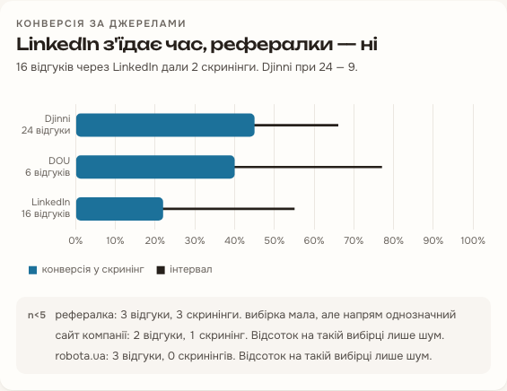
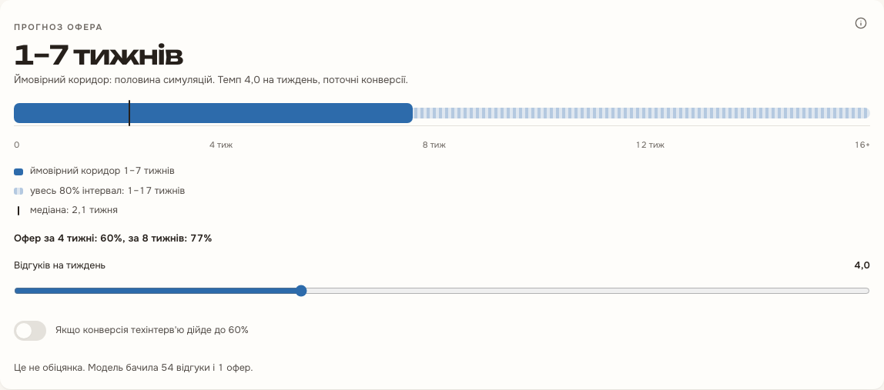
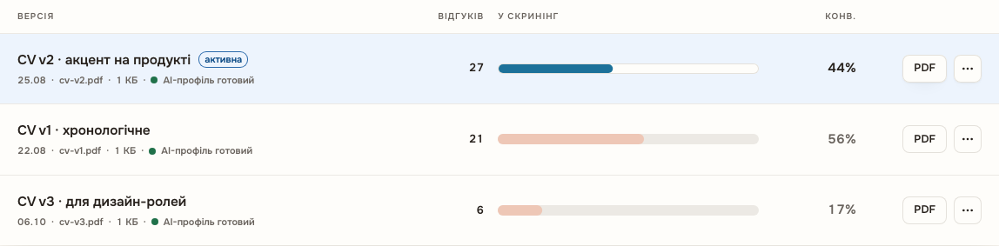

# Методи аналітики

Сервіс `services/analytics` рахує всі метрики з журналу `stage_events` користувача. Метрики лежать у `services/analytics/app/metrics` як чисті функції: на вході DataFrame, на виході pydantic-модель, без звернень до бази чи мережі. Пороги мінімальної вибірки беруться з `packages/shared/src/thresholds.ts` через згенерований `enums.json`: `MIN_N_PERCENT` = 5, `MIN_N_INSIGHT` = 10, `MIN_N_FORECAST` = 15. Нижче порога метрика повертає `insufficient_data` з кількістю заявок, яких бракує.

## Інтервал Вілсона для конверсії

Конверсію етапу і джерела показано як частку з 95% довірчим інтервалом. Функція `wilson_interval` у `services/analytics/app/metrics/rate.py` рахує інтервал Вілсона, бо на малих вибірках він не виходить за межі $[0, 1]$ і не стискається до нуля, як інтервал Вальда.

Для $s$ успіхів з $n$ спроб, $\hat p = s / n$ і $z$ = `Z` = `NormalDist().inv_cdf(0.975)` $\approx 1{,}96$:

$$
c = \hat p + \frac{z^2}{2n}, \qquad
m = z \sqrt{\frac{\hat p (1 - \hat p)}{n} + \frac{z^2}{4n^2}}, \qquad
[L, U] = \left[ \frac{c - m}{1 + z^2 / n},\ \frac{c + m}{1 + z^2 / n} \right].
$$

При $s = 0$ нижня межа дорівнює 0, при $s = n$ верхня дорівнює 1, решту обрізано до $[0, 1]$. Функція `rate` повертає інтервал лише коли $n \ge$ `MIN_N_PERCENT`.

Успіх для конверсії рахує `conversion_counts` у `services/analytics/app/metrics/source_ranking.py`: заявки, що пройшли етап, з усіх, що його досягли, без тих, що зависли в `ghosted`. Рейтинг джерел сортує їх за нижньою межею $L$, тож джерело з трьома успіхами з трьох не обганяє джерело з 30 з 50. Для малої вибірки примітка `SMALL_BUT_CLEAR` з'являється, коли загальна частка всіх джерел лежить поза інтервалом цього джерела.

## Апостеріорний Beta-розподіл імовірності пройти етап

Прогноз першого офера (`services/analytics/app/metrics/forecast.py`, `services/analytics/app/metrics/offer_simulation.py`, опис моделі в `docs/analytics/offer-forecast.md`) працює з чотирма активними етапами: `applied`, `screening`, `tech_interview`, `final`. Для етапу $k$ рахуються $s_k$, заявки, що дійшли далі (пропущений етап вважається пройденим), і $f_k$, заявки, що закінчилися на етапі відмовою або відкликанням. Заявки в `ghosted` і ще відкриті цензуровані й не входять ні в $s_k$, ні в $f_k$.

З рівномірним апріорним $\mathrm{Beta}(1, 1)$ апостеріорний розподіл імовірності пройти етап:

$$
\theta_k \mid s_k, f_k \sim \mathrm{Beta}(1 + s_k,\ 1 + f_k), \qquad
\mathbb{E}[\theta_k] = \frac{1 + s_k}{2 + s_k + f_k}.
$$

У коді це `rng.beta(1 + successes, 1 + failures, (SIMULATIONS, successes.size))` у `pass_chances`. Прогноз з'являється, коли заявок не менше `MIN_N_FORECAST`, є хоча б одна відповідь компанії і кожен етап має хоча б один результат. Інакше кожна $\theta_k$ трималася б лише на апріорному розподілі.

## Прогноз методом Монте-Карло

`first_offer_weeks` проганяє `SIMULATIONS` = 10 000 симуляцій з фіксованим зерном `FORECAST_SEED` = 2026, тому той самий запит завжди дає ту саму відповідь. У кожній симуляції $r$ спершу вибирається вектор $\theta^{(r)}$ з Beta-розподілів, далі рахуються дві групи.

Заявки в роботі. Заявка на етапі $m$, що пробула там $e$ днів, отримує офер, якщо пройде етапи $m, \dots, 4$ (події Бернуллі з імовірностями $\theta_k^{(r)}$). Час до офера:

$$
W_{\text{in}} = \frac{\max(D_m - e,\ 0) + \sum_{k > m} D_k}{7},
$$

де $D_k$ взято бутстрепом з власних тривалостей етапу $k$ користувача, а 7 = `DAYS_PER_WEEK`.

Нові заявки. Темп $\lambda$ рахує `applications_per_week` у `services/analytics/app/metrics/forecast_inputs.py`: заявки за `RATE_WINDOW` (4 тижні), поділені на кількість тижнів з першої заявки, обмежену від 1 до 4, і результат обмежено `PACE_LIMITS` = (1, 4). Заявки, що закінчаться офером, утворюють проріджений пуассонівський потік з інтенсивністю $\lambda \prod_k \theta_k^{(r)}$. Для перших `OFFERED_CANDIDATES` = 64 таких заявок:

$$
T_j = \frac{\sum_{i \le j} E_i}{\lambda \prod_{k} \theta_k^{(r)}}, \quad E_i \sim \mathrm{Exp}(1), \qquad
W_j = T_j + \frac{\sum_k D_{jk}}{7}, \quad T_j < H.
$$

Перший офер у симуляції: $W^{(r)} = \min(W_{\text{in}}, \min_j W_j)$. Якщо $W^{(r)} > H$, де $H$ = `HORIZON_WEEKS` = 52, симуляція рахується як «за горизонтом».

З 10 000 значень $W^{(r)}$ відповідь бере медіану, `likely` (квантилі 0,25 і 0,75), `interval` (0,1 і 0,9), усі через `np.quantile(..., method="inverted_cdf")`, і частки $\Pr(W \le 4)$ та $\Pr(W \le 8)$. Межа за горизонтом повертається як `null`.

Випадкові величини мають форму, що не залежить від $\lambda$, і вибираються в сталому порядку, тому більший темп лише стискає $T_j$ і ніколи не відсуває офер. `services/analytics/tests/metrics/test_forecast_properties.py` перевіряє це через hypothesis. Бектест на 200 синтетичних користувачах описано в `docs/analytics/offer-forecast.md`.

## Байєсівське A/B порівняння версій CV

`resume_ab` у `services/analytics/app/metrics/resume_ab.py` порівнює дві найуживаніші версії резюме: новішу (challenger, $A$) і попередню (baseline, $B$). Успіх для версії рахується тим самим `conversion_counts` на першому етапі: $s$ заявок пройшли `applied` з $n$, що до нього дійшли, без `ghosted`.

`probability_better` у `services/analytics/app/metrics/proportions.py` бере для кожної версії апостеріорний розподіл з рівномірним апріорним і оцінює ймовірність переваги вибіркою:

$$
\theta_A \sim \mathrm{Beta}(1 + s_A,\ 1 + n_A - s_A), \qquad
\theta_B \sim \mathrm{Beta}(1 + s_B,\ 1 + n_B - s_B),
$$

$$
P(\theta_A > \theta_B) \approx \frac{1}{N} \sum_{i=1}^{N} \mathbf{1}\left[\theta_A^{(i)} > \theta_B^{(i)}\right],
$$

де $N$ = `AB_RULES.draws` = 100 000, зерно `AB_RULES.seed` = 2026.

Вердикт будує `verdict`. Поки в меншій з двох версій менше `MIN_N_INSIGHT` спроб, відповідь `insufficient_data`. Далі береться впевненість у лідері $b = \max(P, 1 - P)$: при $b \ge$ `AB_RULES.clear` = 0,95 вердикт каже «CV vN працює краще», при $b \ge$ `AB_RULES.likely` = 0,80 «Схоже, CV vN працює краще», нижче «Різниці між CV vA і CV vB поки не видно» з номерами обох версій.

Поруч відповідь дає частотну перевірку з `proportion_test`: z-тест двох часток з об'єднаною оцінкою, або точний тест Фішера, коли хоча б одна очікувана частота менша за `AB_RULES.min_expected` = 5. Поле `switch` показує конверсію до і після дати, коли почала використовуватися новіша версія.

